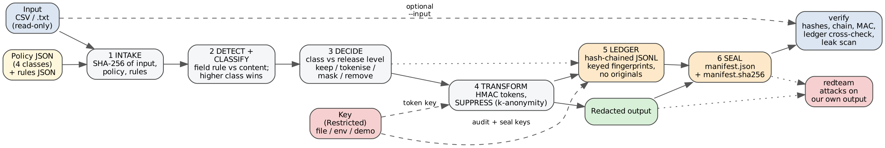
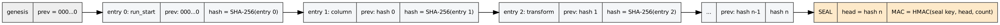

# Architecture



## Modules (`src/veilchain/`)

| Module | Responsibility |
|---|---|
| `policy.py` | Loads the organisation's policy JSON; class order and handling text come only from there. |
| `rules.py` | Maps fields, entities and owner labels onto policy classes; validates them against the policy. |
| `detectors.py` | Pattern detectors (email, phone, card with Luhn check, secrets, private keys, known names, record IDs) with Unicode normalisation. |
| `classify.py` | Field rule versus content: the higher class wins; unknown columns default to Confidential; compares the owner's label with the computed class. |
| `transform.py` | Chooses an action per class and release level and applies it. Produces events that never contain original values. |
| `keys.py` | Key loading, domain-separated sub-keys, safe key generation. |
| `ledger.py` | Hash-chained, sealed JSON Lines audit ledger and its verifier. |
| `bundle.py` | Manifest creation and the verification checks. |
| `leakscan.py` | Searches outputs for originals and seven kinds of re-encoding. |
| `risk.py` | k-anonymity over quasi-identifiers. |
| `pipeline.py` | The end-to-end run: intake, classify, transform, log, seal. |
| `redteam.py`, `evaluate.py`, `synth.py` | Attack suite, precision/recall evaluation, synthetic data generator. |
| `cli.py`, `demo.py` | Command-line interface and the one-command demo. |

Only the Python standard library is used at run time (`hashlib`, `hmac`, `csv`, `re`, `json`, `unicodedata`, `argparse`).

## Decision model

```
cell value  ->  field rule class  \
                                    >  highest class wins  ->  compare with release level
detected content (email, secret...) /
   class == Restricted      -> remove  (no token, no fingerprint)
   class <= release level   -> keep
   otherwise                -> tokenise  (or mask)
```

Release level defaults to *Internal*: Public and Internal values may stay, Confidential values are redacted, Restricted values are always removed. `--release-level Public` redacts Internal values too.

## Keys

One master key gives three independent sub-keys by HMAC domain separation:

| Sub-key | Used for |
|---|---|
| token key | pseudonym tokens in the shared output (`EMAIL#7f3a9c21d4`) |
| audit key | fingerprints in the ledger, so an authorised reviewer can confirm a value was processed without the ledger storing it |
| seal key | MAC over the ledger head, so a rewritten ledger can be detected by anyone holding the key |

Key sources, in order: `--key-file`, `--demo-key` (public, demos only), the `VEILCHAIN_KEY` environment variable, otherwise an ephemeral per-run key. Keys are treated as Restricted: never written to outputs, and `keygen` refuses to write inside a git repository.

## Ledger format



One JSON object per line, for example (shortened):

```json
{"seq":9,"ts":"2026-11-12T02:03:15Z","run":"6c1f...","event":"transform",
 "data":{"entity":"EMAIL","class":"Confidential","action":"tokenise","column":"email",
         "record":"REC-001","loc":"email","detector":"field_rule","out":"EMAIL#bf0641d28d","fp":"3a91c0..."},
 "prev":"<hash of entry 8>","hash":"<SHA-256 of this entry without the hash field>"}
```

Event types: `run_start`, `column`, `transform`, `keep`, `finding`, `run_end`, `seal`. Restricted removals carry **no** `out` and **no** `fp`.

## Manifest (`manifest.json`)

Records the tool version, run ID, UTC times, parameters, key source and key id, SHA-256 of the input, policy and rules, every output file, and the ledger head. It contains no original values, no key material, no absolute paths and no usernames. `manifest.sha256` holds the hash of the manifest itself.

## Verification checks

`veilchain verify <folder> [--input original] [--leak-scan] [--key-file ...]`

1. manifest present and matches `manifest.sha256`
2. every listed file present and unchanged (reports MISSING / CHANGED); unlisted files warned
3. ledger chain intact (modification, deletion, re-ordering, truncation); seal present
4. seal MAC (only with the key; otherwise reported as "not authenticated")
5. ledger versus manifest (entry count; input and output hashes recorded inside the ledger)
6. original input still matches the hash taken at intake
7. leak scan: none of the original sensitive values, nor their encodings, appear in any file

## Exit codes

| Code | Meaning |
|---|---|
| 0 | success / verified |
| 1 | verification failed |
| 2 | run completed but Restricted material was found and removed (rotate the secret) |
| 3 | usage, input or configuration error |

## Mapping to NIST SP 800-86 phases (spirit, not compliance)

| Phase | VeilChain |
|---|---|
| Collection | read-only intake; SHA-256 of the input and policy before anything else |
| Examination | detection and classification under the policy |
| Analysis | label-mismatch findings, k-anonymity risk, red-team results |
| Reporting | summary, explain file, manifest, verification report |

VeilChain is not a forensic acquisition tool. It borrows the discipline (hash first, log every step, re-verify before trusting).
