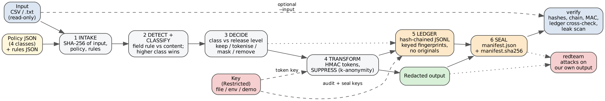

**Intern:** Ishaan Bansal | **Intern ID:** 2436 | **Date:** November 2026\
**Repository:** https://github.com/Gitishaan1/redkross-veilchain *(update if the repository name differs)*\
**Demo video:** [ADD VIDEO LINK]

---

## Abstract

Organisations often need to share records for testing, training or analysis, but the records contain personal data and sometimes secrets. This report describes **VeilChain**, a command-line tool that (1) classifies synthetic records against an organisation's four-class policy (Public, Internal, Confidential, Restricted), (2) redacts what the policy says must not be released, and (3) records every transformation in a **hash-chained audit ledger that never contains the original sensitive values**. A sealed evidence manifest lets anyone re-verify the result. The tool uses only the Python standard library. It was tested with 85 automated tests (35 recorded in a test matrix, all passing) and attacked with a seven-part red-team suite that found and led to the fix of two real weaknesses. The report states plainly what the tool does not do: redaction is not anonymisation, the detectors are pattern-based and miss unknown names and some obfuscations, and a hash chain proves consistency, not authenticity. All data is synthetic.

---

## 1. Problem and scope

**Task.** Build a data-classification and redaction utility that classifies synthetic records, redacts selected fields and logs transformations without storing original sensitive values. The starter pack supplied six synthetic customer records, a policy file (the fictional "Northstar" policy with four classes) and four redaction test cases.

**Why it matters.** A redaction tool that leaks through its own logs, uses reversible "anonymisation", or silently passes a secret is worse than no tool, because it creates false confidence. The design therefore treats the tool's *own outputs* (ledger, manifest, reports) as attack surface.

**Scope and ethics.** Only synthetic data is used (provenance in `data/PROVENANCE.md`). No real personal data, credential or system is involved, no attack is run against anything except VeilChain's own output, and nothing is scanned or tested outside the local machine. VeilChain is a learning project, not a certified privacy product.

**Relation to Task 1.** Task 1 wrote the handling rules for a fictional bank. One limitation it recorded was the lack of a restricted tier for cryptographic keys. The Task 2 policy provides that tier, and VeilChain enforces several Task 1 rules in code (`docs/TASK1_TO_TASK2.md`), for example "secrets must never be written into logs".

## 2. Background and sources

- **NIST SP 800-86** describes forensic work as a four-phase process: collection, examination, analysis and reporting [1]. VeilChain borrows the discipline (hash at intake, log every step, re-verify before trusting) without claiming to be a forensic tool.
- **NIST SP 800-188** covers de-identification, including pseudonymisation, k-anonymity and quasi-identifiers, and cautions that merely masking values is not enough for de-identification [2]. This is why VeilChain adds a re-identification check and states its limits.
- **NIST Privacy Framework** frames privacy as risk management across Identify, Govern, Control, Communicate and Protect functions [3]. VeilChain mainly supports *Control* (data processing management, with minimisation through redaction) and *Protect* (key handling, integrity checks).
- **Python `hashlib` and `hmac`** supply SHA-256 and keyed hashing [5], [6]; HMAC is specified in RFC 2104 [8].
- **CISA #StopRansomware** emphasises preparing for loss and verifying recovery [7]. VeilChain's resilience features are small-scale versions of this: read-only inputs, regenerable outputs and verifiable bundles.

Key concept used throughout: a plain hash of a value only shows that two values are equal. For low-entropy values such as phone numbers, an attacker can hash every possible number and compare, so a **keyed hash (HMAC)** is needed. The red-team results in Section 6 demonstrate this.

## 3. Threat model

**Assets:** original sensitive values; secrets and keys (Restricted); integrity of the redacted output and of the evidence.

**Adversaries considered:** (a) a recipient of the redacted file who tries to recover originals; (b) someone who gets the ledger and manifest; (c) an insider or attacker who alters evidence after the run; (d) a careless operator who leaves a secret in the data.

**Assumptions:** the machine running VeilChain and the key file are trusted at run time; keys are kept outside the repository; the policy and rules files are correct.

**Out of scope:** malware on the host, side channels, protection of the original input file itself, legal compliance claims, and de-identification guarantees.

## 4. Design

**4.1 Policy-driven decisions.** Class names, their order and their handling statements are read from the policy JSON, never hard-coded. A second file (`veilchain_rules.json`) maps fields, entities and the owner's low/medium/high label onto policy classes, and is validated against the policy (an unknown class stops the run). Every decision is explained by quoting the policy, for example, for RED-03 (`REC-003`): the record ID is Internal, the release level is Internal, so it may stay; policy: "Share only with authorised staff."

**4.2 Classification.** A cell's class is the *higher* of its field rule and what its content actually contains (email, phone, card number validated with the Luhn checksum, secret assignments, bearer tokens, private-key blocks, known names, record IDs). Unknown columns default to Confidential (default deny). A record's class is the highest class of its cells. The tool compares this computed class with the owner's label and reports disagreements: REC-001 and REC-005 are labelled "low" yet hold a name, email and phone number that the policy treats as Confidential, so they are flagged as **under-classified**.

**4.3 Actions.** Relative to a *release level* (default Internal):

| Class of the data | Action |
|---|---|
| Restricted | **remove**; no token and no fingerprint is kept anywhere |
| above the release level | **tokenise** (keyed pseudonym such as `EMAIL#bf0641d28d`) or **mask** (`[EMAIL]`) |
| at or below the release level | keep |

The same real-world value always yields the same token under the same key (so records can still be joined), and different keys give unlinkable tokens. Values are normalised first, so `maya.example@example.com` and `MAYA.EXAMPLE[at]EXAMPLE[dot]COM` get the same token.

**4.4 Keys.** One master key yields three sub-keys by HMAC domain separation: a token key (output pseudonyms), an audit key (ledger fingerprints) and a seal key (ledger MAC). Keys are Restricted material: never written to outputs, a key file is refused inside a git repository, and a public demo key is clearly flagged.

**4.5 Logging without originals.** The ledger records event type, class, action, column, record ID, detector, the output token and a keyed *fingerprint* (so an authorised reviewer holding the audit key and a suspected value can confirm it was processed, while the ledger itself cannot be reversed). Restricted removals carry neither token nor fingerprint.

**4.6 Tamper-evident ledger and evidence bundle.** Each ledger entry contains the SHA-256 of the previous entry. A final seal entry carries a keyed MAC over the chain head. `manifest.json` records SHA-256 hashes of the input, policy, rules, every output file and the ledger head; `manifest.sha256` protects the manifest. `verify` re-computes everything, reports MISSING and CHANGED files, checks the chain and seal, cross-checks the hashes recorded inside the ledger against the manifest, and optionally scans all output files for the original values and seven re-encodings of them (case, whitespace removed, digits only, URL-encoded, base64 in three forms, hex).

**4.7 Fail closed and non-destructive.** Inputs are opened read-only and hashed before and after. Output folders must be new or empty and files are created in exclusive mode, so evidence can never be overwritten. If Restricted material is found, the run finishes but exits with code 2 and prints that the secret must be treated as exposed and rotated, because removing it from one copy does not un-leak it.

## 5. Implementation

About 3,000 lines of Python (`src/veilchain/`, standard library only; written for Python 3.10 or later and tested on Python 3.12) and about 900 lines of tests. Commands: `classify`, `redact`, `verify`, `risk`, `keygen`, `redteam`, `eval` and `demo` (the whole story in one command). Output is plain ASCII so it works on any Windows console. Exit codes: 0 success, 1 verification failed, 2 Restricted material found, 3 usage or input error. Architecture, formats and file-by-file responsibilities are in `docs/ARCHITECTURE.md`.

## 6. Testing, evidence and results

**Method.** (1) 85 automated pytest tests: unit tests for detectors, policy and rules; behavioural tests for redaction; integrity tests; and attack tests. (2) A **test matrix** of 35 cases (`docs/test_matrix.md`) generated by a pytest plugin: each case records what the test *expected* and what was *observed* during the run. (3) A seven-attack **red-team suite** and (4) a **precision and recall evaluation** on a labelled synthetic corpus. Raw outputs are in `evidence/`.

**6.1 Test matrix summary** (all 35 cases pass in the final run):

| Case (examples) | Observed |
|---|---|
| TM-01 dummy PII in the provided records | 18 values tokenised, 6 kept; 0 originals in any output file |
| TM-02 the four provided test cases | RED-01 name and email redacted; RED-02 phone redacted; RED-03 kept with a policy explanation; RED-04 unchanged |
| TM-03 / TM-04 determinism and unlinkability | same key: identical output hash; different keys: 0 of 6 tokens shared |
| TM-07 / TM-08 Restricted material | exit code 2; no fingerprint stored for removed secrets |
| TM-12 / TM-13 privacy risk and labels | k = 1 before suppression, 2 records suppressed; 2 under-classified records reported |
| TM-16 bad inputs | empty, missing, invalid UTF-8, duplicate header, output folder in use: each exits with code 3; nothing overwritten |
| TM-18 performance | 20,000 records (60,000 tokenised values) in about 6 s on the build machine |
| TM-21 unchanged file | 12 checks, 0 failures |
| TM-22 / TM-23 changed / missing file | CHANGED and MISSING reported, exit code 1 |
| TM-24 successful restore | output regenerated from the untouched original is byte-identical and verifies |
| TM-25 / TM-26 failed verification | edited, deleted, swapped, truncated and removed ledger: all detected |
| TM-31 leak scan | 0 leaks across 18 originals; planted plain, base64, hex, URL-encoded and digits-only copies all found |

**6.2 Red-team results** (`evidence/redteam_after_fixes/`):

| ID | Attack | Outcome | Result |
|---|---|---|---|
| RT-1 | brute-force reversal of tokens | DEFENDED | v0 unkeyed: 50/50 phone numbers recovered in 0.6 s; v1 HMAC: 0/50 without the key; with a stolen key 50/50 |
| RT-2 | leak scan, with scanner self-test | DEFENDED | 0 leaks; planted copy caught |
| RT-3 | linkage through department + label | DEFENDED | k 1 to 2 after suppression |
| RT-4 | obfuscated PII | PARTIAL | 12/12 designed-for evasions caught; 7 out-of-scope ones slip through |
| RT-5 | derivations of secrets stored anywhere | DEFENDED | 0 found (after the fix below) |
| RT-6 | eight tampering attacks | PARTIAL | 7/8 detected without the key, 8/8 with it |
| RT-7 | linkage across releases | DEFENDED | same key 20/20 linkable; different keys 0/20 |

**6.3 Failures found and fixed** (full list: `docs/BUILD_LOG.md`).

1. **Weak v0 tokens (deliberate baseline).** SHA-256 of a phone number was reversed in 0.6 s (RT-1). Fixed by keyed HMAC tokens; retested in TM-33.
2. **A real bug: multi-line private keys leaked.** `.txt` input was processed line by line, so only the `BEGIN` line of a key block was removed and the key body stayed in the output. Red-team RT-5 reported BROKEN. Fix: process the whole file as one text. Regression test TM-11; RT-5 now DEFENDED.
3. **An evidence gap.** Editing the output *and* the manifest together passed verification (RT-6g). Fix: `verify` now cross-checks the hashes recorded inside the ledger. Regression test TM-30.

**6.4 Detector quality** (400 synthetic lines, seed 1337; `evidence/detector_evaluation.md`):

| Group | Entity | Precision | Recall |
|---|---|---:|---:|
| standard | EMAIL, CARD, PERSON (known), SECRET, RECORD_ID | 1.00 | 1.00 |
| standard | PHONE | 0.89 (8 false positives) | 1.00 |
| evasion | EMAIL | 1.00 | 0.58 |
| evasion | PHONE | 1.00 | 1.00 |
| unknown name | PERSON | n/a | 0.00 |

The phone false positives come from a deliberate hard negative (a part number shaped like a phone number). Unknown names are missed by design. The corpus is generated by the same code that defines its ground truth, so these scores show how well the detectors match *these* patterns and say little about real-world data.

## 7. Limitations

1. **Redaction is not anonymisation.** Tokens are stable per key, so patterns, frequencies and linkage remain. NIST SP 800-188 warns that masking alone does not give de-identification [2]. The k-anonymity check is deliberately simple (two quasi-identifiers, small data) and the suppressed value itself marks a record as unusual.
2. **Pattern detectors.** No machine learning. Unknown names, spelled-out, reversed, letter-spaced and encoded values are missed (RT-4, evaluation). Obfuscated PII needs additional controls such as review or data-loss prevention.
3. **Key custody.** If the token key is stolen, all tokens can be reversed in seconds (RT-1). The keys are Restricted material and must be protected outside the tool.
4. **A hash chain is consistency, not authenticity.** Without the key, an attacker who rewrites ledger, output and manifest consistently is not detected (RT-6h). Anchoring the ledger head hash outside the machine (for example in a git commit) or verifying the keyed seal closes this.
5. **Synthetic evaluation.** Precision and recall are measured on generated data shaped like the detectors' patterns. Locale-specific formats (for example national ID numbers) are not covered.
6. **Interpretation choices.** The policy does not list payment cards or the owner's low/medium/high labels. The mapping used (cards as Confidential; low to Internal, medium and high to Confidential) is documented in `policy/veilchain_rules.json` and is a design choice.
7. **Not legal advice and not a compliance claim.** The tool has not been audited.
8. **Scale.** Tested to 20,000 records in memory; very large files would need streaming.

## 8. Future work

Named-entity recognition for unknown names (with its own error measurement); streaming for large files; external anchoring of the ledger head (for example a signed commit); a differential-privacy or generalisation option for quasi-identifiers; and testing the tool with a real review by a second person.

## 9. Process and transparency

VeilChain was conceptualised, designed, developed, and tested by me (Ishaan Bansal). My contributions include idea generation, system architecture, complete source-code implementation, test development and execution, debugging, security analysis, and validation of results.

Claude (Anthropic) was used as a supplementary assistant for generating the MIT License, creating and formatting PDFs and architectural diagrams, clarifying doubts regarding my proposed ideas, and explaining unfamiliar technical concepts during development. All figures in this report come from commands that were actually run (the logs are in `evidence/`).

## 10. References

Access dates are the dates the pages were located (11 November 2026). Items marked † were identified through search results or summaries and should be opened and read in full before being relied upon.

| # | Reference | Used for |
|---|---|---|
| [1] | National Institute of Standards and Technology, "Guide to Integrating Forensic Techniques into Incident Response," NIST SP 800-86, Aug. 2006. https://csrc.nist.gov/pubs/sp/800/86/final | Four-phase forensic process; hash-first discipline |
| [2] | National Institute of Standards and Technology, "De-Identifying Government Datasets: Techniques and Governance," NIST SP 800-188, Sep. 2023. https://csrc.nist.gov/pubs/sp/800/188/final † | k-anonymity, quasi-identifiers, the limits of masking |
| [3] | National Institute of Standards and Technology, "NIST Privacy Framework: A Tool for Improving Privacy through Enterprise Risk Management, Version 1.0," Jan. 2020. https://www.nist.gov/privacy-framework † (a Version 1.1 update has been in progress; check which version is current) | Framing of Control and Protect functions |
| [4] | National Institute of Standards and Technology, "Guide to Protecting the Confidentiality of Personally Identifiable Information (PII)," NIST SP 800-122, Apr. 2010. https://csrc.nist.gov/pubs/sp/800/122/final † | Background on PII protection |
| [5] | Python Software Foundation, "hashlib: Secure hashes and message digests," Python 3 documentation. https://docs.python.org/3/library/hashlib.html | SHA-256 |
| [6] | Python Software Foundation, "hmac: Keyed-hashing for message authentication," Python 3 documentation. https://docs.python.org/3/library/hmac.html | HMAC, constant-time comparison |
| [7] | CISA and MS-ISAC, "#StopRansomware Guide." https://www.cisa.gov/stopransomware † | Resilience framing: recovery and verification |
| [8] | H. Krawczyk, M. Bellare and R. Canetti, "HMAC: Keyed-Hashing for Message Authentication," RFC 2104, 1997. https://www.rfc-editor.org/rfc/rfc2104 † | HMAC construction |
| [9] | D. Eastlake and A. Panitz, "Reserved Top Level DNS Names," RFC 2606, 1999. https://www.rfc-editor.org/rfc/rfc2606 † | Safe synthetic email domains |
| [10] | MITRE, "CWE-532: Insertion of Sensitive Information into Log File." https://cwe.mitre.org/data/definitions/532.html † | Why secrets must not reach logs |
| [11] | L. Sweeney, "k-anonymity: A model for protecting privacy," *Int. J. Uncertainty, Fuzziness and Knowledge-Based Systems*, vol. 10, no. 5, pp. 557-570, 2002. † | k-anonymity concept |
| [12] | I. Bansal, "Data Classification and Handling Guide for a Bank" (RedKross Task 1 technical report), Oct. 2026. https://github.com/Gitishaan1/redkross-data-handling-guide | Rules that VeilChain enforces |
